# 김효준 — 게임 기획 · 시스템 설계 포트폴리오

> 국민대학교 소프트웨어학부 (2027년 2월 졸업 예정) · miro08@naver.com · [github.com/myojun08](https://github.com/myojun08)
>
> **규칙과 구조로 재미를 만듭니다.** 증상을 고치는 대신 증상을 만드는 규칙을 바꾸고, 반복되는 확인은 눈이 아니라 데이터로 옮기고, 판단할 때마다 「왜」와 「무엇을 접었나」를 같이 적습니다. 2026년부터는 AI 에이전트 셋을 지휘해 제품 하나를 혼자 끝까지 끌고 갔습니다.

| 프로젝트 | 기간 | 역할 | 바로 가기 |
|---|---|---|---|
| **재정 교육 웹게임 4종** — 한국재정정보원 「열린재정」 | 2026.08 ~ 진행 중 | 1인 (기획 · 게임 설계 · 데이터 · AI 에이전트 지휘 · 발주처 대응) | [플레이(데모)](https://merry-torrone-82bbe2.netlify.app) |
| **Eternal Mortis** — 절차 생성 던전 (졸업작품, 4인) | 2026.02 ~ 2026.07 | 레벨 디자이너 (맵 생성 시스템 · 방 기믹 · 런 상태 C++) | [플레이(itch.io)](https://ssutte.itch.io/eternal-mortis) · [영상](https://youtu.be/sZACJJffqs4) · [저장소](https://github.com/kookmin-sw/2026-capstone-08) |

---

## 1. 재정 교육 웹게임 4종 — 쓸 수 있는 수단이 거의 없을 때 무엇을 만드는가

한국재정정보원의 공개 서비스 「열린재정」에 올라갈 재정 교육 게임입니다. 복원소(OX · 유물 복원) · OX 키퍼(OX · 골키퍼) · 재정 골든벨(미니게임 6종) · 나의 재정 성향(16유형). 2026년 8월 말부터 혼자 맡아 기획 · 게임 설계 · 문항 데이터 · 아트 디렉션 · 발주처 대응을 했고, 10월부터는 서버(Node + PostgreSQL)까지 붙여 개발 서버에서 돌고 있습니다.

  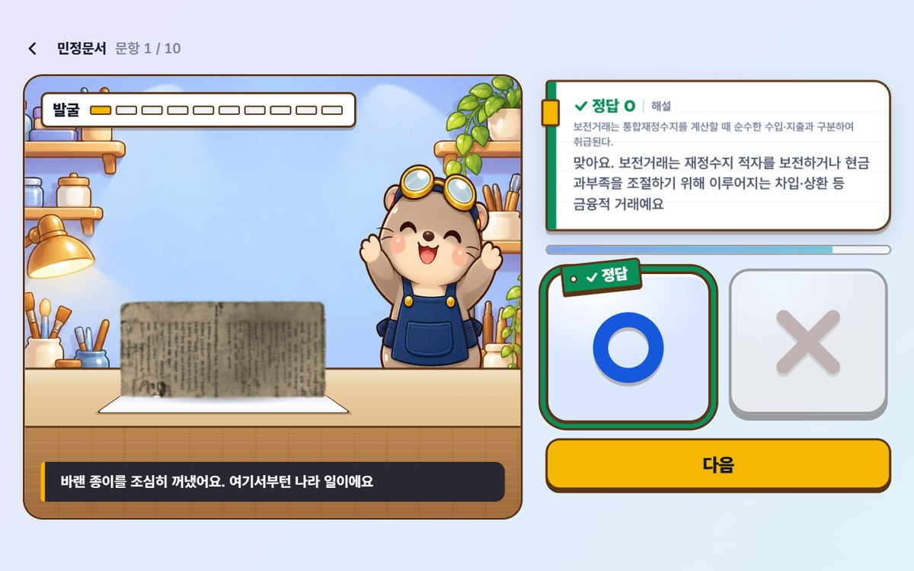 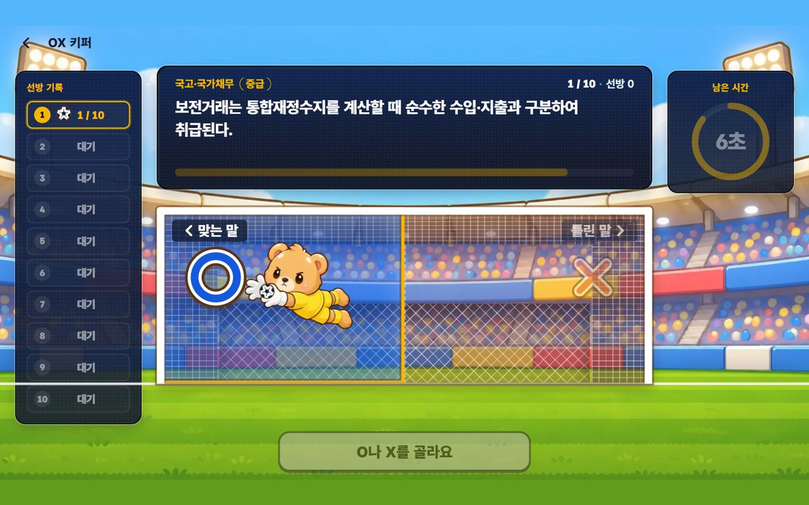
  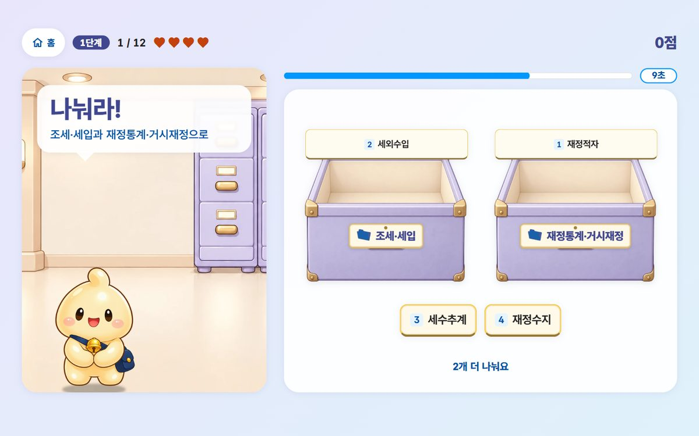 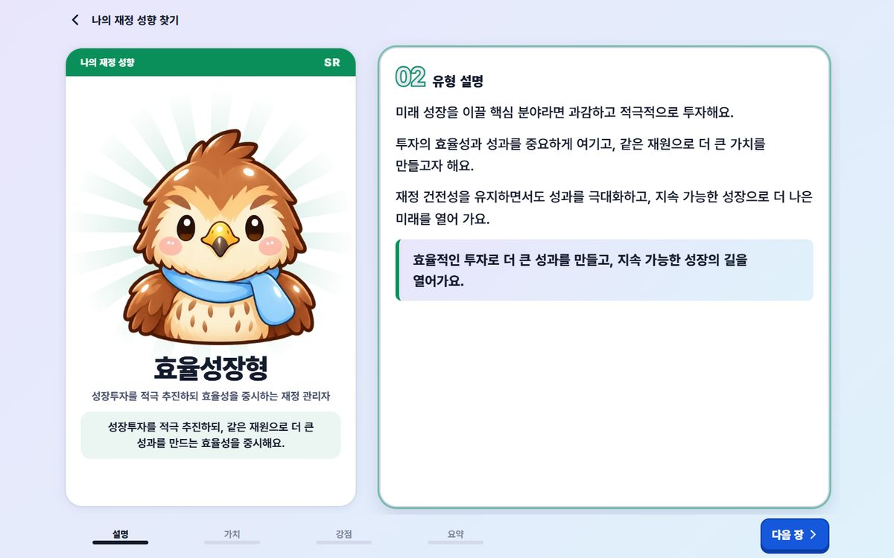

  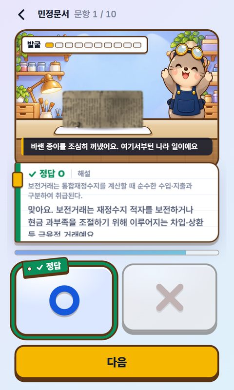 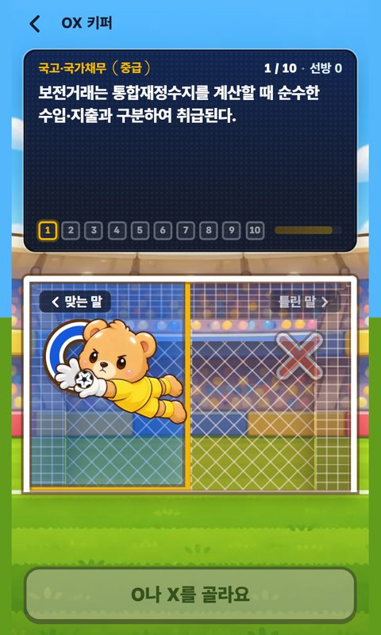 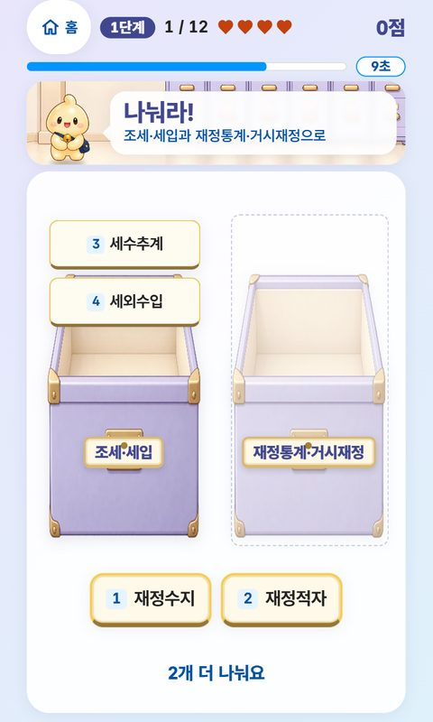 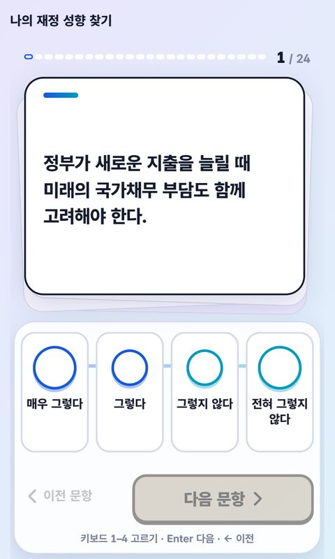

### 1.1 제약 — 캐주얼 게임이 재미를 만드는 수단 셋을 전부 못 쓴다

| 지렛대 | 시중 사례 | 가능? | 왜 |
|---|---|---|---|
| 조작 숙련 | 타이밍 게임 | ✕ | O/X는 연습해도 늘지 않는다 |
| 사회적 경쟁 | 순위표 · 친구 비교 | ✕ | 로그인 · 이용자 간 비교 금지 |
| 보상 | 아이템 해금 · 코인 | ✕ | 공공 서비스라 보상 구조 금지 |

여기에 정치적 중립, 저사양 모바일(360×600, GPU 메모리 100~250MB), 지역 연상 금지, 산출물 일체 발주처 귀속, 1인, 3개월이 붙습니다. 이 조건에서만 나오는 답을 찾는 것이 일의 전부였습니다.

### 1.2 설계 결정 — 연출이 아니라 구조를 바꿨다

**세 방향을 돌아가는 상태까지 만들고 전부 접었다.** OX에 붙일 연출로 타워 · 러너 · 굴리기를 각각 플레이 가능한 상태까지 만든 뒤 셋 다 버렸습니다. 전부 「문장을 읽는다 → 버튼 하나 → 2초 연출 → 반복」이라 이용자의 개입이 8초에 한 번뿐이었기 때문입니다. 연출을 바꿔도 이 구조는 안 변합니다. 비교 대상을 「다른 교육 게임」에서 「시중 캐주얼 게임」으로 바꾸자 문제가 보였고, 레퍼런스에서 가져온 것은 그림이 아니라 **리듬을 끊는 지점**이었습니다. 조작 구간은 빠르게, 학습 구간은 완전 정지.

**타워를 버리고 복원 구조로.** 층이 쌓이는 구조에서는 8점과 10점의 차이가 「지붕 하나 더」입니다. 문항을 맞힐 때마다 유물이 **질적으로 다른 상태**(발굴 → 세척 → 접합 → 복원 → 전시)로 바뀌는 5단계로 바꿨습니다. 이미 만든 타워 화면과 에셋을 버리는 결정이었습니다.

**혼자 하는 게임에서 「남을 보는 감각」을 집계로 냈다.** 순위표가 금지인데 골든벨의 재미는 탈락을 눈으로 보는 데 있습니다. 문항별 실제 정답률로 그 자리를 채웠습니다. 「20명이 탈락했습니다」가 아니라 「오늘 이 문제, 100명 중 36명이 놓쳤어요」. 마스코트만 색이 있고 나머지는 실루엣, 빈자리는 그대로 남깁니다.

**만들지 않고 접은 것도 넷.** 그중 제일 아까웠던 것이 예산 배분 육성 게임입니다. 트레이드오프를 몸으로 익히게 하는 데 육성 구조만 한 게 없는데, 「복지에 많이 배분하면 이렇게 된다」를 게임이 단정하는 순간 그 자체가 정책 주장이 됩니다. 어떤 배분이 옳은지는 가치 판단이고 정부기관 콘텐츠가 정답을 제시할 근거가 없어 접었습니다. 같은 이유로 「지출 = 새는 물」 「채무 = 무거운 짐」 같은 은유도 금지 규칙에 넣고 그림 지시서마다 걸렀습니다.

**「카드를 통으로 옮긴다」만 일곱 종이었다.** 미니게임 일곱 종이 조작은 달라도 전부 「카드를 집어 어딘가에 놓는다」였습니다. 방향을 뒤집어 도구가 움직이는 종(「찍어라」: 서류는 가만히, 도장을 골라 찍는다)을 만들었습니다. 「이어라」는 만들어 놓고 손맛이 겹쳐 풀에서 뺐습니다.

**판정 연출을 종마다 만들다가 하나로 합쳤다.** 한 판에 네 종이 나오니 판정 화면을 네 번 새로 읽어야 했습니다. 판정이 화면을 통째로 덮고 그 뒤에 해설이 올라오게 바꿔 종별 판정 코드를 전부 지웠습니다. 줄어든 코드가 결과입니다.

### 1.3 데이터에서 게임을 끌어냈다

- 발주처가 준 300문항 엑셀에 `핵심용어 · 대분류 · 뜻 · 난이도` 칸이 따로 있었습니다. **이 네 칸이면 미니게임 여섯 종이 나온다**는 것을 찾아, 골든벨 문항 15세트를 150세트(그중 133개 자동 생성)로 늘렸습니다. 조사(은/는 · 이/가)도 받침을 보고 코드가 붙입니다.
- 오답 규칙에서 한 번 틀렸습니다. 「재정수지(ㅈㅈㅅㅈ)」에 오답 음절 「체 · 흑」이 붙어 초성만 보고 풀리는 문제가 됐고, 정답과 초성이 같은 글자만 오답으로 쓰도록 고쳤습니다.
- 답이 둘이 되는 세트 12건이 나왔을 때 12건을 고치는 대신 **「같이 나오면 안 되는 쌍」을 규칙으로** 적었습니다. 150 → 141세트가 됐지만 용어가 늘어도 재발하지 않습니다.
- 판 구성을 배열에서 규칙으로 바꾸고 **3,000판을 생성해 검증**했습니다. 「배경이 한 판 안에서 안 겹친다」는 규칙을 2,984판이 못 지켰는데, 규칙이 아니라 데이터(그 배경을 쓰는 문항이 셋뿐)가 문제였습니다. 종을 먼저 균등하게 고르고 그 안에서 문항을 뽑도록 바꿔 풀이 커져도 등장 비율이 안 흔들리게 했습니다.
- 「오늘의 문제」는 누가 언제 들어와도 그날은 같은 문제여야 합니다. 세우는 규칙 넷으로는 86일 중 6일이 답이 전부 같았고(아무거나 눌러도 만점), 규칙을 더 정교하게 만드는 대신 줄 전체를 훑어 고쳤습니다. 지금은 서버 배치가 400일치를 미리 편성하고 빈 날을 스스로 채웁니다.
- OX X문항 42건이 원본의 옳은 설명을 그대로 두고 정답만 X로 뒤집어 놓은 것이었습니다. 자동 검수는 14건만 잡았고(문장이 문법적으로 멀쩡해서), 원본 300문항과 한 줄씩 대조해 복원했습니다.

### 1.4 로그인 없이 지표 다섯을 내는 구조

발주처가 요청한 지표(방문자 · 완주율 · 문항별 정답률 · 플레이타임 · 재방문률)는 전부 집계값입니다. 서버에는 「누가」가 없습니다. 익명 세션 하나만 받고 IP 원문 · UA · 식별자는 받지 않습니다. 재방문은 브라우저가 「7일 안에 왔었나」를 스스로 계산해 참/거짓 하나만 보냅니다.

요청받은 다섯으로는 「왜 나갔나」를 알 수 없어 넷을 더 설계했습니다. **중단 문항 + 중단 구간**(명령 직후 / 조작 중 / 해설 중 / 결과 화면 — 결과 화면에서 나간 건 이탈이 아니라 만족입니다), **몇 판째인가**(재시도가 완주율보다 강한 재미 신호), **해설 체류 시간**(로그인 없는 교육 콘텐츠에서 학습이 일어났는지의 유일한 근사치), **무엇을 골랐는지**(틀린 사람의 80%가 X를 골랐다 = 오개념이 퍼져 있다).

### 1.5 10월 — 서버를 붙이고 정답을 번들에서 뺐다

정답과 해설이 브라우저 번들에 있으면 순위표가 의미를 잃습니다. 판 시작 → 문항 한 장씩 발급 → 서버 판정 → 판 끝 → 등수 · 별명 · 순위표를 서버가 맡도록 바꿨습니다(Node 22 + PostgreSQL 16, docker compose, API 명세 16절). 남은 시간 보너스도 브라우저가 보낸 값이 아니라 **서버가 문항을 연 시각**으로 셉니다. 별명은 형용사 + 동물 조합을 뽑되 명예의 전당 안에서 안 겹치게 번호를 붙이고, 순위표에는 판 ID를 내려보내지 않습니다(남의 별명을 바꿀 수 있던 구멍). 골든벨은 「같은 날 같은 판」을 유지하면서 카드 키와 순서만 새로 섞습니다.

### 1.6 품질을 어떻게 통제했나 — 눈이 아니라 데이터로

| 수단 | 무엇을 | 규모 |
|---|---|---|
| 촬영기 (headless Chrome 직접 제어) | 네 게임 전 흐름을 누르며 글 넘침 · 44px 미만 터치 영역 · 콘솔 오류 · 흐름 끊김을 잰다. 폰 · PC 폭 · 키보드 전용 · 실패 경로까지 | 스크립트 10 · 한 바퀴 97장면 · 문제 0건이어야 통과 |
| 서버 스모크 · 단위 검사 | 판 시작 재전송 · 동시 판정 경주 · 거짓 시간 · 순위표 조작 · 요청 상한 | 검사 41 · 단위 7 |
| AI 세 도구 교차 검수 | 같은 지시서를 Claude · Codex · Antigravity에 주고 결과를 합본, **재현된 것만** 고침 | 서버 검수 32건 · 코드 검수 14건 · 「과한 것」 검수 39건(결함 12 고침 · 죽은 코드 · 그림 848KB 삭제) |
| 결정기록 · 지시서 | 판단마다 왜 그랬는지, 무엇을 접었는지. 그림 · 구현 · 검수 지시서는 어느 도구에 줘도 같은 결과가 나오게 | 결정기록 261줄 · 지시서 18 · 검수 문서 22 |

### 1.7 AI 에이전트와 일하는 방식

10월의 재구축은 **AI 에이전트 셋(Claude Code · Codex · Antigravity)을 지휘해** 만들었습니다. 코드의 대부분은 에이전트가 썼고, 제 몫은 요구와 제약을 글로 못 박는 것, 화면을 보고 틀린 곳을 짚는 것, 결정하는 것, 그리고 에이전트끼리 서로 검수하게 하는 것이었습니다.

- **역할을 나눈다.** 메인 세션이 설계 · 구현, 서브에이전트가 정리 작업을 병렬로, Codex가 그림 생성과 교차 검수, Antigravity가 「못 본 것」 검수. 지시서 한 장을 셋에게 똑같이 주고 결과가 일치하는지 봅니다.
- **AI는 게임을 해 본 적이 없다.** 발산을 맡기면 위키 요약이 나옵니다. 축을 먼저 세우고 빈칸을 만든 다음 채우게 했고, 「직접 해 보니 이게 재밌었다」는 사람 몫으로 남겼습니다.
- **멈추지 않게 한다.** 완료 조건 · 금지 · 검사 명령을 지시에 넣고, 이어받기 문서 한 장으로 세션이 바뀌어도 같은 자리에서 잇습니다.
- **검수 결과를 그대로 믿지 않는다.** 세 도구가 낸 100건 넘는 지적 중 코드에서 재현된 것만 고쳤고, 오판(예: 의도된 브라우저 호환 코드를 중복으로 본 것)은 이유와 함께 기록에 남겼습니다.
- **과한 것도 지운다.** 「넣은 것」만이 아니라 「안 써도 되는 것」을 따로 검수시켜 이전 판 이식본 48파일, 안 쓰는 상수 22개, 그림 62장을 걷어냈습니다.

### 1.8 숫자

| | |
|---|---|
| 게임 | 4종 (OX 2 · 골든벨 미니게임 6종 · 성향 16유형) |
| 문항 | OX 86 · 골든벨 용어 67 + 손 문항 16 → 세트 141 · 오늘의 문제 400일 자동 편성 |
| 코드 | 화면 + 서버 13,800줄 · 커밋 179 (10월 재구축분) |
| 문서 | 기획서 2,330줄 · API 명세 · 테이블 정의서 V0.2 · 결정기록 · QA 계획서 |
| 검증 | 촬영기 97장면 × 폭 2 · 스모크 41 · 단위 7 · AI 교차 검수 3도구 |
| 만들었다 접은 것 | 게임 방향 3 · 미니게임 2 · 테마 1 · 문서로만 검토해 접은 방향 4 |

> 산출물 권리는 발주처에 있어 저장소는 비공개입니다. 화면은 공개 데모 링크와 위 캡처로 대신합니다.

---

## 2. Eternal Mortis — 매 런 다른 던전을 만드는 규칙

Unreal Engine 5.6 · 3D 소울라이크 + 로그라이트 · 국민대학교 졸업작품(캡스톤) · 4인 팀 · 2026.02 ~ 07 · itch.io 배포. 저는 **레벨 디자이너**로 절차 생성 맵, 층 구조와 컨셉 전환, 방 단위 전투 · 잠금 기믹, 몬스터 스폰 파이프라인, 실외 환경 자동 배치, 조명, 런 상태 C++ 서브시스템, 멀티 엔딩 분기를 맡았습니다.

  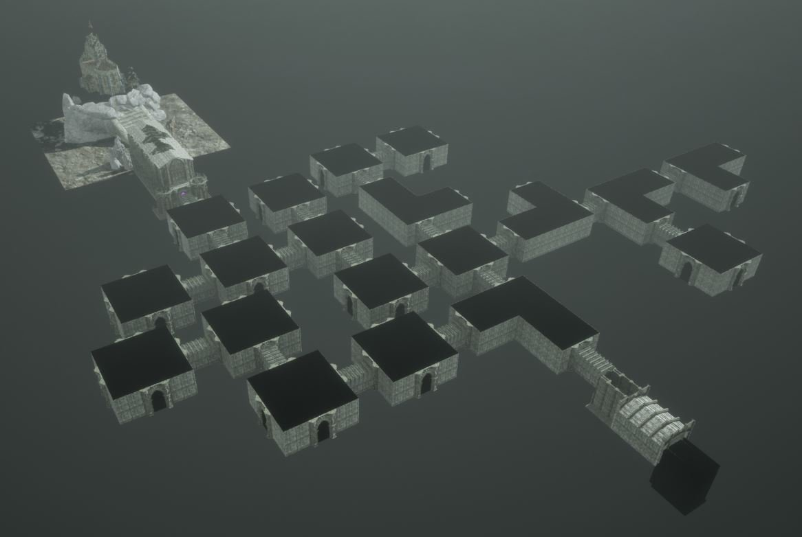

  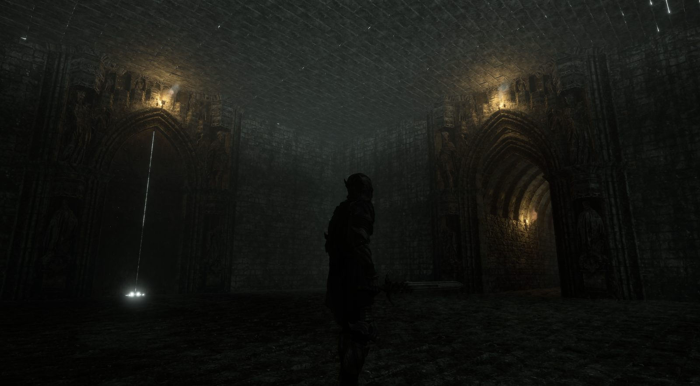 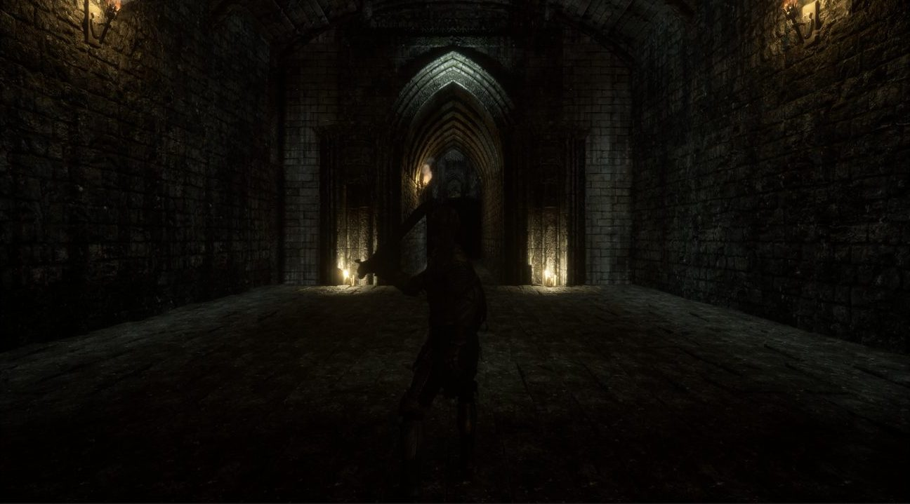

### 2.1 생성 규칙 — 그래프 탐색 없이 프리팹 조립 + 충돌 검사

미리 만든 방 프리팹을 **연결점(Arrow Component)** 기준으로 이어 붙입니다. BFS/DFS나 시드 난수 대신 「뻗어 보고 겹치면 취소」 한 가지 규칙으로 실내 · 실외 던전을 같은 알고리즘이 만듭니다.

| 단계 | 규칙 |
|---|---|
| 1 시작 방 | StartRoom을 놓고 확장 가능한 연결점을 모은다 |
| 2 방향 셔플 | 확장 방향을 섞어 무작위성을 확보한다 |
| 3 확장 + 충돌 검사 | 연결점에서 새 방을 스폰, 기존 방과 겹치면 취소. 못 뻗은 연결점의 문은 벽으로 막는다 |
| 4 특수방 | 20% 확률로 상점 · 보물 · 제단. 끝난 뒤 상점과 보물이 각각 **최소 1개** 있는지 확인해 없으면 일반 방을 바꾼다 |
| 5 반복 | 목표 방 개수(층별 DataTable)까지 2~4 반복. 최대 14방 |
| 6 보스 · 계단 | 일반 방이 끝난 뒤 보스방과 계단방을 배치한다 |

- **방은 전부 `BP_RoomBase`의 자식.** RoomType(Start · Combat · Boss · Treasure · Event · Corridor · Store · Stair) · 활성화 · 클리어 · SpawnedEnemies · LockedDoors · **ConnectedRooms**를 한 곳에서 관리합니다. 연결 정보는 인접 방 몬스터 미리 스폰(팝인 제거)과 잠금 범위 결정 두 군데에 씁니다.
- **방 목록은 DataTable.** `DT_Level1Rooms` · `DT_Level2Rooms` · `DT_Level3Rooms`로 컨셉마다 분리해 프리팹을 더하거나 바꿀 때 블루프린트를 안 건드립니다. 층별 최대 방 수 · 특수방 수도 표로 뺐습니다.
- **층 6개 = 컨셉 3개 × 2층.** 지하감옥(폐쇄 · 어둠 · 좁은 통로) → 성 내부(넓은 홀 · 횃불 · 가벽 기습) → 식인마을(실외 · 자연광 · 환경물 자동 배치). 층 전환은 항상 별도 레벨 Open Level로 — 같은 레벨 재로드 시 PIE 크래시를 피하기 위해서입니다.
- **실외는 비어 보였다.** PCG를 시도했다가 UE 5.6 호환 문제로 접고 `BP_EnvironmentSpawner`로 전환. 맵 범위 안에 랜덤 포인트를 찍고 방 · 통로와 겹치지 않는 곳에만 나무 · 풀 · 바위를 HISM으로 심습니다.

### 2.2 방 잠금 · 스폰 · 엔딩

- **잠금 방(강제 전투).** 전투방 일부를 50% 확률로 잠급니다. 진입하면 통로 문만 골라 닫고(`Door` 태그), 적 전멸(`OnDestroyed` 바인딩, 타이머 폴링 폐기) 시 엽니다.
- **지연 스폰.** 게임 시작 시 일괄 스폰하지 않고 진입 방 + 인접 미클리어 전투방에만 스폰해 동시 활성 AI 수를 줄입니다. NavMesh는 런타임 Dynamic 생성.
- **런 상태는 C++ 서브시스템.** `MortisRunStateSubsystem`(GameInstanceSubsystem)이 층 · 컨셉 · 재화 · 부활 비용 · 마지막 방 · 진엔딩 플래그를 들고, Open Level 사이에서 상태를 지킵니다. GameInstance 변수에서 옮기면서 상태 보존과 책임 분리를 한 번에 해결했습니다.
- **멀티 엔딩.** 6층 게이트에서 저주 3개 이상이면 진보스로. 열쇠의 룬을 얻었으면 진엔딩, 아니면 노말 엔딩.

### 2.3 근본 원인에서 고친 버그 셋

**잠금 확률 50%가 거의 100%로 동작했다.** 벽에 붙어 걸을 때 더 자주 잠기는 것을 보고 확률 값이 아니라 판정 시점을 의심했습니다. 판정이 방의 Box Collision 오버랩에 직접 묶여 있었고, 박스가 방보다 작아 벽 주행 중 나갔다 들어오기를 반복하며 「1회 50%」가 「N회 시행」이 돼 1에 수렴한 것이었습니다. `bRoomActivated`로 방당 판정 1회를 보장했습니다. 확률 판정은 반복 이벤트가 아니라 **상태 전이 시점**에 묶어야 합니다.

**환경물이 동선을 침범했다. 회피 로직은 그대로인데.** 추적하니 팀원이 다른 작업 중 RoomBase의 콜리전 채널을 바꿨고, 제 스포너는 옛 채널을 조회해 오버랩이 항상 빈 배열이었습니다. 「겹치는 방이 없다」로 읽혀 그대로 심은 것입니다. 채널을 통일해 해결했고, 빈 결과가 「없음」인지 「못 찾음」인지 구분되지 않는 API는 실패가 드러나지 않는다는 것, 파트 간 공유하는 채널 · 태그 · 이름은 바꿀 때 영향 범위를 같이 봐야 한다는 것을 배웠습니다.

**잠금 방에서 죽으면 잠긴 채 부활해 진행이 막혔다.** 서브시스템에 `LastVisitedRoom`을 저장하고 부활 시 그 방의 LockedDoors를 순회해 강제로 엽니다.

### 2.4 회고

프리팹 조립은 프로토타이핑이 빨랐지만 그리드 기반이 아니라 미니맵 좌표 변환에서 막혀 미니맵을 접었습니다. 초기에 좌표계 정합성을 더 봤어야 했습니다. 반복된 런타임 버그를 `IsValid` 같은 임시 회피가 아니라 타이밍 · 채널 · 중복 실행이라는 원인에서 잡은 경험이 이 프로젝트에서 가장 남는 것입니다.

---

## 3. 기술

| 구분 | 내용 |
|---|---|
| 게임 | Unreal Engine 5 (Blueprint · C++ Subsystem · DataTable · GAS 연동 · Lumen · HISM · Runtime NavMesh) |
| 웹 | TypeScript · Next.js 16 · React 19 · CSS Modules · Web Audio |
| 서버 · 데이터 | Node 22 · PostgreSQL 16 · docker compose · nginx · Python(openpyxl) 데이터 파싱 |
| 검증 | Chrome DevTools Protocol 자동 촬영 · 시뮬레이션 검증(3,000판 · 86일) · 스모크 · 단위 검사 |
| AI 에이전트 | Claude Code · Codex · Antigravity — 역할 분담 · 지시서 · 교차 검수 · 이어받기 운용 |
| 자격 | AWS Certified AI Practitioner (AIF-C01) |
